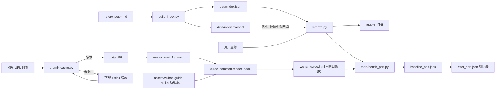

## Product Overview
对 `suming-saig-agent` 整个专家包做端到端性能优化，覆盖四层：脚本运行耗时（线路模式图片预取、RAG 索引加载）、交付页面体积与首屏（底图、内联缩略图）、上下文 token 成本（`wuhan-guide/SKILL.md` 与 agent 说明）、以及仓库工具链与打包产物。改造前先建立可复现的量化基线，改造后给出同一口径的前后对比。

## Core Features
- **量化基线先行**：用离线快照与固定样本测出 map 模式与 route 模式的端到端耗时、产物体积、RAG 检索耗时、文档字节数与 token 估算，落盘为基线快照，避免"凭感觉优化"。
- **线路卡片图片流水线提速与瘦身**：缩略图跨运行持久缓存（同一 URL 不再重复下载）、提高并发、缩短单图超时、下调缩略图尺寸与质量、限制每卡内联图片数，使二次生成的图片阶段从数十秒级降到秒级，且页面体积明显下降。
- **底图与页面首屏优化**：压缩 870KB 底图（质量与渐进式编码），产物页与底图同名同目录的复制在内容未变时跳过，减少一次大文件写入。
- **上下文瘦身**：把 `wuhan-guide/SKILL.md` 中偏工程维护的章节下沉到 `references/`，`SKILL.md` 只保留触发条件、模式判定、调用命令与回答约束；同步精简 agent 说明中与之重复的细节，降低每次技能触发加载的 token。
- **RAG 检索加载加速**：构建期额外产出二进制索引缓存，运行期优先加载并校验一致性、异常自动回退 JSON；索引数值改为整型缩放存储以压缩体积，检索结果与现有评测指标不得回退。
- **交付物一致性**：全部改动后仍通过模板默认块与线路文档两道校验，重新打包并给出包体积变化。

## 约束与边界
- 不新增第三方依赖（无 PIL），图像处理只依赖 macOS `sips` 与标准库，且 `sips` 仅在构建期用于压缩入库底图。
- 不改任何 CLI 契约与输出字段；页面文件名保持 ASCII；`--inline-image` 能力保留。
- 缓存必须可缺失：目录不可写、条目损坏、版本不符时静默降级为不缓存/回退 JSON，绝不阻断主流程。
- `assets/wuhan-guide-map.html` 模板受精确字符串替换与 `.gitattributes` 保护，改动面越小越好。


## Tech Stack Selection
沿用现状，不引入新依赖：
- 语言/运行时：Python 3.9.6 标准库（`hashlib`、`marshal`、`os.replace`、`concurrent.futures`、`shutil`、`tempfile`）。
- 图像处理：macOS `sips`（仅构建期压缩入库底图与运行时缩略图回退）；`PIL` 已有代码分支保留但不依赖。
- 页面：现有单页模板 + 字符串注入链路不变。
- 度量：新增纯标准库基准脚本，子进程调用真实 CLI，保证测的是生产路径。

## Implementation Approach
按"先度量、再改、再复测"的顺序推进，四类改动互不阻塞、可独立回滚：

1. **基线**：新增 `tools/bench_perf.py`，用 `tools/route_snapshot.json` 离线构造记录，分四组测量：`map` 模式端到端与产物体积；`route` 卡片渲染的图片阶段（首次/二次，各取中位数）；`retrieve.py` CLI 端到端（重复 5 次取中位）；文档字节数与 token 估算（中文按 1 字符 ≈ 0.7–1 token 给出区间，明确标注为估算）。输出 JSON 快照 + 控制台表格。

2. **图片流水线（收益最大）**：新增 `scripts/thumb_cache.py`，把缩略图从"每次临时目录"改为"持久缓存"：
   - 缓存根 `~/.cache/wuhan-guide/thumbs`，可用 `WUHAN_GUIDE_CACHE` 覆盖；不可写时回退为原地临时目录（行为等价于现状）。
   - 缓存键 `sha256(url)[:32] + "-" + 规格串`（规格含边长、质量、格式），规格变化自然失效，无需手动清理。
   - 存 `data URI` 文本，原子写（临时文件 + `os.replace`），读失败视同未命中；入库时按 mtime 做 LRU 清理（上限 800 条 / 60MB，超出批量淘汰最旧）。
   - `query_route.py` 改动：`make_thumb` 先查缓存；缩略图 220px→176px、质量 82→72；单图超时 15s→8s；`IMAGE_WORKERS` 8→12；每卡最多内联 2 图（`img1`、`img2`），第 3 图只保留在数据里不内联。
   - 失败路径保持现状：单图失败仅 stderr 提示并跳过，不影响页面生成。

3. **底图与复制**：用 `sips -Z 1400 -s formatOptions 78` 重编码（保持像素尺寸与 `width/height` 属性一致，避免改模板结构）。`guide_common._apply_map_image` 在复制前比较目标文件的 size + mtime，一致则跳过写入；仍保留原子替换语义。不做 `srcset`（改动模板与校验链路风险高于收益，列为后续可选项）。

4. **RAG 索引加载**：`build_index.py` 在写完 `index.json` 后追加写 `data/index.marshal`（`marshal.dump` 基本类型，规避 pickle 的代码执行风险），并把加权词频 `tfw` 与 `doc_len` 改为整型（×2 缩放，索引里记 `scale`）以压缩体积；`retrieve.py` 加载时按 `index.marshal` 的 mtime ≥ `index.json`、`version`/`tokenizer` 一致才用，否则回退 JSON 并在 stderr 说明。分词器签名校验逻辑不变。
   - 复杂度与瓶颈：检索本体为 `O(Σ df_t)`，实测 1.2ms，改造不改算法；收益来自把 ~100ms 的纯文本解析换成 ~10–20ms 的 `marshal.load`，以及索引体积下降约 15–20%。

5. **上下文瘦身**：`wuhan-guide/SKILL.md` 26.8KB 拆为「主干 + 两份 references」：主干保留目的/何时使用/模式判定/两条命令/回答约束/资源清单；`references/route_mode.md` 收纳线路模式的实现细节与参数表，`references/maintenance.md` 收纳维护约定（模板保护、校验脚本、重建流程）。`agents/jing-xiao-wu.md` 只保留能力边界与路由，与 SKILL.md 重复的细节删掉并指向技能。撤掉的表述不得让 agent 失去"必须一次脚本调用""不暴露内部引用"等硬约束。

## Implementation Notes
- **基准可复现**：route 模式的图片阶段依赖外网，基准脚本对同一组 URL 连跑两次（未命中/命中）取中位数；网络异常样本剔除并记录条数，避免偶发抖动污染结论。
- **缓存正确性**：缓存键包含规格串，改尺寸/质量不会读到旧图；`data URI` 文本整体读写，避免半截文件（原子写 + 失败删除）。
- **降级优先**：缓存目录创建失败（只读盘、沙箱）→ 走临时目录并 stderr 提示一次，不抛异常。
- **指标回退红线**：`python3 tools/eval_rag.py --compare tools/eval/baseline_v1.json tools/eval/current_v2.json` 的 Recall@1 0.8077 / Recall@3 1.0 / 越界误答率 0 不得下降；索引整型化后需重新生成并复核。
- **模板红线**：不改 `assets/wuhan-guide-map.html` 的注入标记与 `` 行；若压缩后文件尺寸变化，`width/height` 属性保持不变（仅体积变化，不影响布局）。
- **打包红线**：`tools/pack_expert.py` 的两道校验必须通过；新增 `references/` 文档与 `thumb_cache.py` 会自动入包，需核对包体积符合预期。
- **爆炸半径**：`saig-spu-rag` 与 `wuhan-guide` 互不影响；`tools/route_snapshot.json`、`data/chunks.json` 内容语义不变。

## Architecture Design


## Directory Structure
```
skills/wuhan-guide/
├── SKILL.md                              # [MODIFY] 瘦身到约 14-16KB：保留触发条件/模式判定/两条命令/回答约束/资源清单；工程细节移出
├── references/
│   ├── route_mode.md                     # [NEW] 线路模式细节：参数表、代理排除规则、图片与卡片策略、常见错误处理
│   └── maintenance.md                    # [NEW] 维护约定：模板精确替换保护、spots.json 校验、gen_route_docs/sync_template_defaults 校验流程、重建步骤
├── assets/
│   └── wuhan-guide-map.jpg               # [MODIFY] sips 重编码（保持 1400x1592，quality 78，体积目标 ≤550KB），像素尺寸不变以免影响模板 width/height
└── scripts/
    ├── thumb_cache.py                    # [NEW] 缩略图持久缓存：缓存根解析（WUHAN_GUIDE_CACHE 覆盖）、cache_key(url, spec)、load/store(data URI, 原子写)、prune(条目/体积双上限 LRU)、不可写时返回 None 以触发临时目录降级
    ├── query_route.py                    # [MODIFY] make_thumb 接缓存；缩略图 176px/q72；超时 8s；IMAGE_WORKERS=12；每卡最多内联 2 图；统计输出命中/下载数量
    └── guide_common.py                   # [MODIFY] _apply_map_image 复制前比对 size+mtime，一致则跳过；保留原子写与异常语义

skills/saig-spu-rag/
├── scripts/
│   ├── build_index.py                    # [MODIFY] 写完 index.json 后追加 index.marshal；tfw/doc_len 改整型（scale=2）；统计输出索引与 marshal 体积
│   └── retrieve.py                       # [MODIFY] load() 优先 marshal（mtime/version/tokenizer 三重校验），失败回退 JSON；score 计算按 scale 还原
└── data/
    ├── index.json                        # [REBUILD] 整型化后的 v2 索引（体积目标 -15%~20%）
    └── index.marshal                     # [NEW] 同内容的二进制快照，供快速加载

agents/
└── jing-xiao-wu.md                       # [MODIFY] 精简重复细节，保留能力边界、路由表与硬约束，指向技能文档

tools/
├── bench_perf.py                         # [NEW] 性能基线与对比：map 端到端/产物体积、route 图片阶段（首跑与缓存命中）、retrieve CLI 端到端、文档字节与 token 估算；支持 --save 与 --compare
└── eval/
    ├── baseline_perf.json                # [NEW] 改造前基线快照（入包，供回归）
    └── after_perf.json                   # [NEW] 改造后结果快照

dist/
└── jing-xiao-wu-1.2.0.zip                # [REBUILD] 重新打包，核对包体积与两道校验
```

## Key Code Structures
```python
# skills/wuhan-guide/scripts/thumb_cache.py
def cache_root() -> str | None: ...                 # ~/.cache/wuhan-guide/thumbs，可用 WUHAN_GUIDE_CACHE 覆盖；不可建则返回 None
def cache_key(url: str, spec: str) -> str: ...      # sha256(url + "|" + spec)[:32]
def load(key: str) -> str | None: ...               # 返回 data URI 文本，缺失/损坏返回 None
def store(key: str, data_uri: str) -> None: ...     # 原子写；失败静默忽略
def prune(max_entries: int = 800, max_bytes: int = 60 * 1024 * 1024) -> None: ...  # 按 mtime LRU 批量淘汰

# skills/saig-spu-rag/scripts/retrieve.py
def load(): ...   # 先试 index.marshal（mtime ≥ index.json 且 version/tokenizer 一致），否则 json.load(index.json)
```


## Agent Extensions
### Skill
- **skill-creator**
  - Purpose: 在把 `skills/wuhan-guide/SKILL.md` 拆分为主干 + `references/` 时，按技能规范校对 frontmatter、章节结构、资源清单与「资源引用必须真实存在」的要求，确保瘦身后规则不丢、引用不断。
  - Expected outcome: 瘦身后的 `SKILL.md` 结构合规、章节无悬空引用，两份新 `references/` 文档被正确挂到「资源」章节，`agents/jing-xiao-wu.md` 的指向仍然有效。

### SubAgent
- **code-explorer**
  - Purpose: 定位所有依赖被改文件的下游消费方——`guide_common` 的 `MAP_IMAGE`/`render_page` 调用点、`thumb_cache` 需替换的临时目录逻辑、`index.json` 的读取方、SKILL.md 中会被下沉的章节被哪些文档引用。
  - Expected outcome: 给出一份「受影响文件与调用点清单」，确保改造覆盖完整、不遗漏 README/打包脚本/校验脚本中的硬编码路径或引用。
