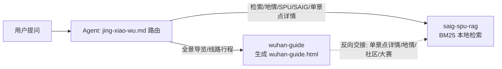

## 用户需求

将「数命SPU城市AI接待员」项目整体精简为两个技能：保留新整合的检索技能 `saig-spu-rag`（本地 BM25 RAG，覆盖 SPU/数命SPU社区/SAIG大赛/《武汉概览》背景）与地图线路技能 `wuhan-guide`；删除其余四个基于 Dify 的旧技能目录，并移除随之失效的共享工具脚本与校验，使项目结构、清单、Agent 路由与文档保持一致、无死代码。

## 核心特性

- 删除 `saig-intro`、`shuming-spu-intro`、`wuhan-intro`、`wuhan-scenic-intro` 四个旧技能目录及其全部子文件。
- 删除仅被旧技能使用的共享工具：`tools/dify_client.py`、`tools/sync_dify_client.py`。
- 将 `tools/gen_route_docs.py` 精简为只生成 `wuhan-guide` 的 `route_codes.md`（移除已失效的 `route_overview.md` 生成逻辑）。
- 从 `tools/pack_expert.py` 移除「Dify 副本」前置校验。
- 更新 `.codebuddy-plugin/plugin.json` 的 `skills` 列表与描述/标签/快捷提示，仅声明 `saig-spu-rag` 与 `wuhan-guide`。
- 重写 `agents/jing-xiao-wu.md` 路由表：所有检索/单景点详情/玩法/讲解词/城市地情/SPU/SAIG 统一路由到 `saig-spu-rag`；地图与线路（`map`/`route`）保留 `wuhan-guide`；删除 Dify 会话环境变量说明。
- 更新 `skills/wuhan-guide/SKILL.md` 的交接表，把原指向已删技能的「交给谁」改为 `saig-spu-rag`。
- 同步 `README.md` 的目录结构与维护脚本说明。
- 最终用 `python3 tools/pack_expert.py --list` 与残留校验确认无漂移、清单引用真实存在。

## 技术栈

- 项目形态：CodeBuddy/WorkBuddy 插件（单一 Agent + 多个独立安装技能目录），无构建步骤，纯文档 + Python 维护脚本（Python 3）。
- 保留实现：
- `skills/saig-spu-rag`：本地 BM25 检索（`scripts/build_index.py`、`scripts/retrieve.py`，预构建产物 `data/chunks.json`、`data/index.json`），无 Dify、无会话。
- `skills/wuhan-guide`：自含 `scripts/show_map.py`、`scripts/query_route.py`、`scripts/guide_common.py` 与 `tools/route_snapshot.json`、`tools/sync_template_defaults.py`，不依赖共享 `dify_client`（已确认 0 匹配）。

## 实现策略

整体采用「删目录 + 收敛引用 + 精简工具」三步走，确保删除旧技能后不产生悬空引用、失效校验或死代码：

1. **物理删除**：直接移除四个旧技能目录与两个 Dify 共享脚本，这是最小、最安全的收敛起点。
2. **声明收敛**：更新 `plugin.json` 的 `skills` 数组与元信息，使其只指向现有两个技能；`pack_expert.py` 的 `verify_refs` 会校验清单引用真实存在，删除后必须同步清单，否则打包即报错。
3. **路由重写**：`jing-xiao-wu.md` 是全局唯一事实源，其 5 技能路由表与 Dify 会话变量必须收缩为 2 技能；`saig-spu-rag` 无会话机制，原 `WUHAN_/WUHAN_SCENIC_/SPU_/SAIG_DIFY_CONVERSATION_ID` 复用约定应删除并改为「BM25 检索、单次调用、无会话」。
4. **交接表同步**：`wuhan-guide/SKILL.md` 的「不要接到本技能」表原把单景点详情/城市地情/社区大赛指向已删技能，统一改为 `saig-spu-rag`（用户已声明所有检索整合进该技能）。
5. **工具精简**：`gen_route_docs.py` 仅保留 `route_codes.md` 生成与 `--check`/`--snapshot`/`--write` 与该文档相关的校验；移除 `OVERVIEW_DOC` 常量、`_overview()` 及其在 `build()` 的调用；`pack_expert.py` 的 `CHECKS` 移除「Dify 副本」项。

## 关键决策与权衡

- **不保留 Dify 工具**：用户已确认「一并精简」，且 `dify_client.py` 仅被已删的 4 技能使用，留之即死代码；彻底移除优于加「已弃用」注释。
- **不删 `route_snapshot.json`/`sync_template_defaults.py`**：二者仍服务于 `wuhan-guide` 的 `route_codes.md` 生成与模板默认块，保留以维持打包链路完整。
- **Agent 不改名/不变更 agentName**：`plugin.json` 的 `name`/`agentName` 一致性校验（`pack_expert.py`）要求不变，仅收缩技能与文案。

## 性能与可靠性

- 删除后重跑 `python3 tools/pack_expert.py --list` 作为回归验证，确认：清单引用存在、仅剩 2 个技能、`gen_route_docs --check` 通过、`sync_template_defaults --check` 通过（Dify 校验已移除）。
- `gen_route_docs.py` 仍复用 `query_route.py` 的 `fetch_records()` 拉全量，本次仅去掉 overview 分支，不影响 `route_codes.md` 生成正确性。

## 架构设计

精简后的插件为「1 Agent + 2 Skill」结构：

- Agent（`jing-xiao-wu.md`）按意图二选一路由：检索类 → `saig-spu-rag`（BM25 本地检索）；地图/线路类 → `wuhan-guide`（生成 `wuhan-guide.html`）。
- `wuhan-guide` 作为地图/线路唯一入口，单景点详情/地情/社区/大赛类问题反向交给 `saig-spu-rag`。



## 目录结构

```
suming-saig-agent/
├── .codebuddy-plugin/
│   └── plugin.json              # [MODIFY] skills 改为 [saig-spu-rag, wuhan-guide]；同步 description/displayDescription/tags/quickPrompts
├── agents/
│   └── jing-xiao-wu.md          # [MODIFY] 重写路由表与核心能力，仅剩 2 技能；删除 Dify 会话环境变量与旧技能引用
├── skills/
│   ├── saig-spu-rag/            # [KEEP] 整合检索技能（含 data/scripts/references）
│   ├── wuhan-guide/             # [KEEP] 地图/线路技能；[MODIFY] SKILL.md 交接表指向 saig-spu-rag
│   ├── saig-intro/              # [DELETE] 整个目录
│   ├── shuming-spu-intro/       # [DELETE] 整个目录
│   ├── wuhan-intro/             # [DELETE] 整个目录
│   └── wuhan-scenic-intro/      # [DELETE] 整个目录
├── tools/
│   ├── dify_client.py           # [DELETE] 仅被已删 4 技能使用
│   ├── sync_dify_client.py      # [DELETE] 同步到已删的 4 个副本
│   ├── gen_route_docs.py        # [MODIFY] 仅生成 wuhan-guide 的 route_codes.md，移除 route_overview.md 相关逻辑
│   ├── pack_expert.py           # [MODIFY] CHECKS 移除「Dify 副本」
│   ├── route_snapshot.json      # [KEEP] gen_route_docs 仍依赖
│   └── sync_template_defaults.py# [KEEP] 服务 wuhan-guide 模板
└── README.md                    # [MODIFY] 目录结构与维护脚本段落同步（去掉 sync_dify_client、route_overview 说明）
```

## 实施注意事项

- 删除目录用 `rm -rf` 而非逐文件，避免遗漏子文件导致校验/打包残留。
- `gen_route_docs.py` 移除 `OVERVIEW_DOC` 与 `_overview()` 后，需同步删除顶部注释中「两份线路参考文档」的相关描述，避免文档与代码不符。
- `jing-xiao-wu.md` 的「输出规范」来源标注：原「武汉知识库（地方志）/武汉景区知识库/数命SPU知识库/SAIG大赛知识库」统一改为 saig-spu-rag 的「数命SPU知识库/《武汉概览》」来源口径，保持与 SKILL.md 一致。
- 所有改动遵循现有 SPDX 许可头与相对路径约定（`skills/<name>/...`），不写死用户目录。