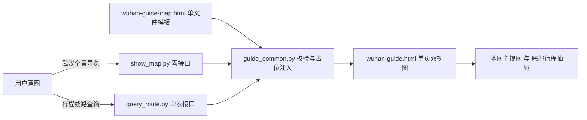

## User Requirements

- 把「武汉全景导览」与「武汉旅游线路查询」两个技能合并为一个「武汉导览」技能，两者原本各自生成的页面也合并为同一份、同名覆盖输出。
- 采用「一个技能 + 单页双视图」：地图为主视图，行程内容以底部抽屉呈现，可展开、可收起；点击线路按钮或点位可唤出抽屉。
- 数据按意图注入：全景导览只给地图与景点清单、行程区显示引导占位；线路查询时才载入行程内容并注入同一页面。
- 统一命名与入口描述，保留原有触发语、按片区编号清单、线路多选高亮、景点简介弹窗与离线可用。

## Product Overview

一个「武汉导览」入口承接两类意图，输出一张单页：上半部是全屏沉浸的手绘全景地图（18 个橙金编号景点、G1–G9 多选线路高亮、鼠标 3D 倾斜、景点简介弹窗），底部是可自下向上滑出的行程抽屉（磨砂玻璃、渐变把手、微动画）。全景导览时抽屉收起并显示引导语与示例问法；线路查询时抽屉铺开对应线路的行程卡片，未覆盖内容淡化。窄屏下抽屉变为贴底全宽面板，地图标签降级为编号牌。整体沿用墨蓝、晴蓝、暖金与柔和渐变，桌面优先、移动自适应，离线即可预览。

## Core Features

- 双意图单页交付：全景导览与线路查询共用同一页面与同一名称，后者覆盖前者，各自只执行一次生成。
- 底部行程抽屉：展开与收起、与线路多选联动、玻璃拟态与微动画、窄屏贴底自适应。
- 按意图注入内容：导览模式零网络、仅地图与按片区编号清单加引导占位；线路模式铺开行程卡片并可按线路筛选。
- 保留既有地图能力：18 个可点击点位、G1–G9 多选高亮与淡化、景点简介弹窗与关闭后焦点回归、3D 倾斜、离线可用。
- 错误透明：行程数据获取失败时如实回显原始提示，不以记忆补写行程内容。

## Tech Stack Selection

沿用现有工程的成熟栈，不引入任何新框架、依赖、CDN 或构建脚本：

- **技能与配置**：Markdown + YAML frontmatter（`SKILL.md`）、JSON（`.codebuddy-plugin/plugin.json`）、Markdown 路由文档。
- **生成脚本**：Python 3 标准库（`argparse` / `urllib.request` / `html` / `base64` / `shutil` / `hashlib` / `re` / `pathlib`）。
- **页面**：单文件 HTML，内联 base64 底图、内联 GSAP 3.12.5、内联 CSS、两段内联脚本（GSAP 业务 IIFE + 独立的 vanilla JS 抽屉逻辑）；无组件库、无外链。
- **验证**：`py_compile`、脚本自检项、浏览器端自动化验收。

## Implementation Approach

**策略**：把两份产物收敛为「一个技能目录 + 一份带占位符的单文件模板 + 一个共享渲染模块 + 两个薄入口脚本」，按意图（导览 / 线路）各执行一次脚本、注入不同内容、写出同一个 ASCII 文件名的页面。

**关键决策与权衡**：

1. **两个入口脚本而非重写单一巨脚本**：`query_route.py` 现有 809 行（接口、字段归一化、缩略图并发、stdout 文字行程单、`--days/--find/--all/codes/--no-sort/--no-image` 全部保留）。把它整体重写进新脚本改动面过大；改为在新技能目录内保留两个入口，各自仍只调用 1 次，用共享模块消除重复。代价是 `SKILL.md` 需按意图明确选脚本，靠清晰的双模式工作流约束。
2. **模板化注入替代原样复制**：现状是「读全文校验 + `shutil.copyfile` 原样复制」。方案 B 的必要代价是改为「读模板 → 精确字符串替换三个占位符 → 原子写（临时文件 + `os.replace`）」，保证幂等覆盖、不出现半截页面；这是唯一能同时承载地图与行程卡的方式。
3. **行程卡片段化 + CSS 作用域化**：`render_cards()` 拼的是完整独立页（`doctype`、`head`、`style`、`body` 外壳齐全）；改造为只返回 `（CSS, HTML 片段）`。`CARDS_CSS` 中 `*{box-sizing}` 与 `body{...}` 是全局规则，与地图 `:root`、`body`、`@media(max-width:650px)` 直接冲突，必须把全部选择器作用域到抽屉挂载点并加类名前缀，否则会破坏地图布局与窄屏降级。
4. **抽屉脚本独立于 GSAP IIFE**：地图业务脚本开头有 `if (!window.gsap) { warn; return; }` 早退，把抽屉逻辑塞进该 IIFE 会在 GSAP 失效时被连带跳过。因此放在业务 `script` 结束之后、页面 `body` 结束之前的独立 `script`，纯 vanilla JS + CSS 过渡，不依赖 GSAP，也不触碰热区的 `transform`。
5. **错误透明优先**：线路模式接口 `fetch_records()` 抛 `SystemExit` 时非零退出、不写也不覆盖页面、stderr 原样回显错误；`SKILL.md` 明确不得凭记忆补写行程。抽屉的「降级」只对应导览模式的引导占位，不伪装成行程数据。
6. **两种模式下 G1–G9 的一致语义**：导览模式仍只做本地高亮筛选（沿用 `applyRoutes()`），点击时唤起抽屉显示引导占位；线路模式抽屉按卡片上的线路标记过滤已注入内容，与地图高亮联动但互不干扰。

**性能与复杂度**：模板约 2.07MB、含单行 base64。单次读入内存，3 次 `str.replace`，一次写出，时间与空间均为 O(n)（n≈2.2MB），内存峰值约 2–4MB；导览模式零网络、零外部请求，耗时主要在磁盘写。校验正则只锚定短标签行，绝不在 base64 长行上跑正则。线路模式接口仅 1 次（timeout=60），`build_thumbs()` 的并发下载、URL 去重与外链回退沿用既有实现，禁止为「先文字、后页面」执行两次脚本。前端抽屉只切 class 与 CSS `transform`/`opacity`，不触发 GSAP 重排、不逐帧遍历 18 个节点。瓶颈是 2MB 写出与缩略图 base64 编码，以原子替换与既有去重缓解。

**避免技术债**：复用现有 `parse_spots` / `parse_routes` / `AREA_GROUPS` / `preview_hint` / `render()`，抽出重复的 `NON_PREVIEWABLE_ROOTS` 与预览提示为唯一共享模块；保留 GSAP 内联与许可头、18 个景点文案与编号、`data-spots` 映射；不新增占位符框架（无 `string.Template` / Jinja 必要），仅用三个自解释 token。

## Implementation Notes

- **行尾与精确编辑**：模板为 CRLF 且含 71KB 级压缩行与 2MB 级 base64 单行。必须用 `open(..., newline="")` 读写、精确字符串替换；禁止整文件重排、统一行尾或格式化。`Path.read_text(newline=...)` 曾导致改动未落盘，须规避。
- **校验正则的边界**：`show_map.py` 的 `BUTTON_RE` / `ROUTE_BTN_RE` 强校验 18 个 `hotspot` 按钮与 9 个 `route-btn`。新增抽屉 DOM 一律使用独立 id 与前缀类名，绝不复用这两个 class，否则触发数量校验报错。
- **可访问性**：保留 `aria-pressed`、`aria-labelledby`、`role="dialog"`、`aria-modal` 与关闭后焦点回归；抽屉新增 `aria-expanded`/`aria-controls`，把手键盘可达、Escape 可收起、焦点不丢失。
- **日志约定**：stdout 为用户可见正文（页面路径、按片区清单、文字行程单），stderr 为运行元数据（来源、热区/线路数、sha256 前 16、预览 403 提示、接口与图片统计）。禁止打印 base64、接口原始大 payload 或任何 PII；接口错误只回显原始错误摘要，不重复刷屏。
- **影响面控制**：先全仓检索旧技能名与旧路径再删除旧目录，特别注意 `agents/jing-xiao-wu.md` 第 35 行把 `skills/wuhan-route-query/references/route_codes.md` 当作零调用本地资料、`skills/wuhan-scenic-intro/*` 的跨技能引用，两者都要随迁移改写。产物固定为工作区内 ASCII 名 `wuhan-guide.html`；不引入 CDN、不引新依赖、不引构建脚本；旧运行期文件 `wuhan-panorama.html` 在确认无引用后清理。
- **失败与幂等**：接口失败不覆盖既有页面；同名输出幂等；写入用临时文件 + 原子替换；退出码非 0 即失败。

## Architecture Design

单页模板是唯一视觉与交互事实源；`guide_common.py` 是唯一渲染契约；两个入口按意图产出内容后交给它注入并写出同一个页面。



数据流：意图 → 入口脚本（导览零网络 / 线路一次 API + stdout 文字行程单）→ `guide_common.py` 读模板、`parse_spots`/`parse_routes` 校验、按三个占位符精确替换、`os.replace` 原子写 → `wuhan-guide.html`。页面内：地图业务 IIFE 继续负责 18 热区、3D 视差、弹窗与 G1–G9 高亮；独立抽屉脚本负责展开/收起、线路联动、焦点与 reduced-motion 降级，二者不共享执行上下文。

## Directory Structure

本次为「新建合并技能 + 删除两个旧技能 + 同步全部注册与路由文档」，涉及文件如下。

```
/Users/wanbarry/suming-saig-agent/
├── skills/
│   └── wuhan-guide/                                   # [NEW] 合并后的唯一技能目录，承接全景导览与线路查询两类意图
│       ├── SKILL.md                                    # [NEW] 单一 frontmatter（name: wuhan-guide、双意图触发语与示例）+ 双模式工作流；明确「导览零接口只给路径+清单」「线路一次调用同时出 stdout 与同名单页」「接口失败不得凭记忆补写」「G1–G9 本地筛选与行程抽屉的边界」；资源节指向下列文件
│       ├── assets/
│       │   └── wuhan-guide-map.html                    # [NEW] 由 wuhan-panorama-map.html 复制改造的单文件模板：保留 336 行结构、内联 GSAP 3.12.5 与许可头、18 个热区、routebar、弹窗与全部原 CSS/JS；新增三个占位符（卡片 CSS、卡片 HTML、模式配置）、body 级底部抽屉容器（第 234 行空处，与弹窗遮罩同级）、head 结束前的作用域化卡片样式位、业务 script 之后的独立抽屉 script；抽屉 CSS 沿用 --ink/--blue/--gold/--panel 渐变语言，不写全局 * 或 body 规则
│       ├── scripts/
│       │   ├── guide_common.py                         # [NEW] 唯一渲染契约与共享工具：占位符常量、load_template()（newline="" 精确读）、render_page()（精确替换 + 临时文件 + os.replace 原子写 + 预览提示）、从 show_map.py 迁来的 parse_spots / parse_routes / AREA_GROUPS / expected_numbering / render_list / preview_hint / NON_PREVIEWABLE_ROOTS，供两个入口共用，消除重复定义
│       │   ├── show_map.py                             # [NEW] 导览模式薄入口：--out 默认 cwd/wuhan-guide.html；零网络、零接口；调用 guide_common 校验并注入「引导占位 + map 模式配置」，stdout 原样回显页面路径 + 一行说明 + 按片区编号清单，stderr 输出来源/热区 18/线路 9/sha256 前 16
│       │   └── query_route.py                          # [NEW] 由旧脚本迁入并改造：保留 fetch_records/normalize/build_thumbs/render 与全套 CLI；把 render_cards() 改为 render_card_fragment() 返回（作用域化 CSS, 卡片 HTML 片段），删除 doctype/head/body 外壳与整页写文件；main() 一次接口调用后先 render() 打 stdout，再经 guide_common.render_page() 注入模板写出同名单页；接口 SystemExit 时不写页面、非零退出、回显原始错误
│       └── references/
│           ├── route_codes.md                          # [MOVE] 原样迁入（9 线路、68 条记录、衔接链、N 日游表、景点速查），供零调用文字快答与代号解析；不含 13 字段明细，仅作字典
│           └── api_reference.md                        # [MOVE] 原样迁入（接口地址、请求体、响应结构、错误码、环境变量），供排查调用问题
│   ├── wuhan-panorama-guide/                           # [DELETE] 内容已全部并入 wuhan-guide；删除前全仓检索确认无剩余引用（含 SKILL.md、agents、README、scenic-intro）
│   └── wuhan-route-query/                              # [DELETE] 同上；其 references 已迁入，须同步改写 agents 第 35 行等指向该目录的路径
├── skills/wuhan-scenic-intro/
│   ├── SKILL.md                                        # [MODIFY] 第 5/32/98/101 行的跨技能路由与排除项描述改为指向 wuhan-guide；G1–G9 概览仍读自有 route_overview.md
│   └── references/route_overview.md                    # [MODIFY] 第 5 行「与 wuhan-route-query 技能同源」改为 wuhan-guide；其余 9 条线路概览不变
├── .codebuddy-plugin/plugin.json                       # [MODIFY] skills 数组第 16/17 两项合并为唯一的 ./skills/wuhan-guide；同步 description（第 4 行）与 displayDescription 中英（第 29–32 行）措辞；quickPrompts 保留「武汉玩一天怎么玩」与「武汉全景导览」并统一指向新技能
├── agents/jing-xiao-wu.md                              # [MODIFY] 核心能力第 3/4 条合并为一条 wuhan-guide；第 35 行零调用资料的 route_codes.md 路径改到新目录；「全景导览 L0 特例」与「行程单 L0 特例」合并为一节双模式特例（脚本名、--out=wuhan-guide.html、同名覆盖、导览零接口、线路先文字后页面、禁止重复调用）；路由表两行合并、分流原则与输出规范例外同步；保留默认一跳直答
├── README.md                                           # [MODIFY] 功能列表第 14/15 条合并为「武汉导览（单页双视图：离线交互地图 + 底部行程抽屉）」；使用示例第 25/26 条保留；顺手清理第 1 行残留的旧绝对路径
├── wuhan-panorama.html                                 # [DELETE] 旧运行期产物，确认无引用后清理，避免与合并页并存造成混淆
└── wuhan-guide.html                                    # [NEW] 运行期产物（不入库源）：两种意图共用同名、幂等覆盖、工作区内 ASCII 名、单文件离线可预览
```

## Key Code Structures

以下为多模块共同依赖的新接口契约，仅列签名与占位符常量（不含实现体），用于防止模板与脚本错配。

```python
# skills/wuhan-guide/scripts/guide_common.py —— 唯一渲染契约
TOKEN_CSS = "__GUIDE_CARDS_CSS__"      # 嵌入 head 结束前的样式位
TOKEN_HTML = "__GUIDE_CARDS_HTML__"    # 嵌入底部抽屉的内容挂载点
TOKEN_MODE = "__GUIDE_MODE__"          # 嵌入独立抽屉 script 的模式配置（map / route）

def load_template() -> str: ...
def validate_template(html: str) -> tuple[list, list]: ...   # 复用 parse_spots / parse_routes
def render_page(*, cards_css: str, cards_html: str, mode: str, out: Path) -> str: ...

# skills/wuhan-guide/scripts/query_route.py —— 片段化渲染
def render_card_fragment(codes, records, heading, sort=True, show_images=True) -> tuple[str, str]: ...
```

## 设计风格

延续地图既有的「暖色手绘地形 + 墨蓝 / 晴蓝 / 暖金」视觉语言，采用玻璃拟态与 Fluent 式柔和层次，不另起风格。桌面优先（约 1500px 居中画布），窄屏自适应贴底面片。整体精致、有呼吸感、具 premium 质感。

## 页面与区块（单页，自上而下 6 块）

- **① 顶部导航条**：左侧竖排 kicker 与主标题「武汉城市探索地图」，右侧副标题与图例说明；细字距、渐入动画，与底部信息条上下呼应。
- **② 全景地图主视图**：圆角 22px 画布、内阴影、18 个橙金编号玻璃标签；鼠标 3D 倾斜、hover 缩放与高亮环，保持全屏沉浸。
- **③ G1–G9 线路控制条**：地图下方横条，9 个胶囊按钮加已选计数与提示；多选高亮覆盖点位、淡化其余。
- **④ 底部行程抽屉（新增）**：贴底磨砂玻璃面板，渐变把手与展开箭头、滑入弹簧动画；导览模式显示引导语与示例问法，线路模式铺开行程卡片；窄屏转全宽贴底。
- **⑤ 景点详情弹窗**：居中磨砂卡片，编号 eyebrow、标题、分类、简介；关闭后焦点回归原热区。
- **⑥ 底部信息条**：简短图例与使用提示，呼应顶部导航，形成完整上下导航结构。

## 交互与动效

抽屉用 CSS transform 与 opacity 过渡（约 .35s 弹性曲线），把手 hover 微抬升并带金蓝流光；卡片 hover 轻微上浮、阴影加深；选中线路时点位与卡片同步渐亮与淡化；`prefers-reduced-motion` 下全部降级为无动画。键盘可达、Escape 收起、焦点不丢失。

## 响应式

≥1200px 抽屉为居中限宽浮层；650–1200px 收窄；≤650px 抽屉全宽贴底、地图标签降级为仅编号牌、控制条落到地图下方，保证 18 个点位仍可点击。

## Agent Extensions

### Skill

- **skill-creator**
- Purpose: 指导新建合并技能 `wuhan-guide` 的 `SKILL.md`，校验单一 frontmatter、双意图触发语、双模式工作流与 L0 档位契约是否符合技能规范。
- Expected outcome: 产出一份可直接注册的 `skills/wuhan-guide/SKILL.md`，明确「导览零接口一次调用」「线路一次调用同时出文字行程单与同名单页」「接口失败不得凭记忆补写」及旧技能引用收敛。
- **playwright-cli**
- Purpose: 在浏览器端验收合并后的单页：两种模式各一次生成、离线零外链、18 个热区命中与焦点回归、G1–G9 多选、抽屉展开收起、窄屏 hit-test、console 无错误、幂等覆盖与接口失败透传。
- Expected outcome: 形成可复核的验证结果与截图，确认导览模式零网络请求、线路模式抽屉正确铺开行程卡片且地图交互未被破坏。