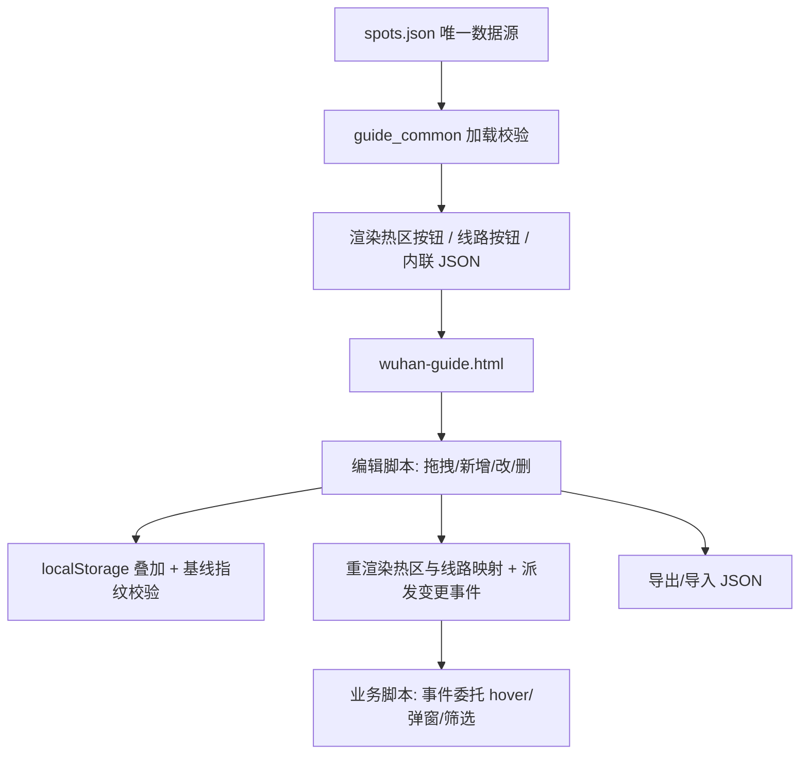

## 用户需求

地图上现有的 18 个景点位置不准、数量偏少，需要重新规划，并要求提供一个可长期使用的景点增删改能力。

## 产品概述

在现有单页双视图（交互地图 + 行程卡片）里加入「景点编辑模式」：用户可直接在页面上拖动景点位置、点击空白处新增景点、点选景点修改名称/类型/简介/所属线路或删除，改动即时生效并保存在本机浏览器，可导出/导入 JSON 备份。编辑按钮常显，任何打开页面的人都能调整，但改动只影响自己本机，不写回接口或仓库。

## 核心功能

- 景点数据化：景点从模板硬编码改为独立数据源，地图标记、编号、片区清单、线路高亮映射都由数据生成，数量不再固定为 18。
- 拖动定位：编辑模式下按住景点即可拖动，实时更新坐标，越界自动收在边缘内。
- 空白新增：编辑模式下点击地图空白处新增一个景点，自动分配编号并打开属性面板。
- 属性编辑：可修改名称、类型、简介、所属线路（G1–G9 多选）、坐标数值，也可删除该景点。
- 即时联动：增删改后编号自动重排，线路按钮覆盖的点位与高亮筛选同步变化，片区清单同步更新。
- 本地保存：改动自动写入浏览器本地存储，刷新后保留；提供导出 JSON、导入 JSON、恢复默认三种操作。
- 数据失效保护：页面重新生成后若内置数据已变，旧的本地改动自动判定为过期并回退到新数据，避免旧坐标覆盖新景点。

## 技术栈

- 前端：单文件 HTML + 内联 CSS + 原生 JS（vanilla），内联 GSAP 3.12.5，base64 底图，零外链。
- 数据与构建：Python（`guide_common.py` 渲染契约、`show_map.py` / `query_route.py` 双入口），JSON 作为景点唯一数据源。
- 验收：playwright-cli + 本地 `python3 -m http.server 8765`。

## 实现方案

### 总体策略

把「景点」从模板 DOM 提升为数据：新增 `assets/spots.json` 作为唯一事实源，生成器在写页面前把它渲染成热区按钮、线路按钮与内联 JSON 数据块；页面内的编辑脚本只读写这份内联 JSON（叠加 localStorage），不依赖 Python，也不写回仓库。

### 关键决策与理由

- **编号由数组顺序派生，不落库**：`spots.json` 只保留 `name/type/desc/x/y/w/area/routes`，`data-no` 与清单编号由生成器按数组顺序生成。增删后自然重排，避免编号字段与数组顺序不一致这类脏数据。
- **线路映射反转为「景点声明所属线路」**：`routes` 写在景点上，9 个线路按钮的 `data-spots` 由生成器反推。编辑时改一个景点的线路归属，按钮映射自动同步，不需要用户维护编号列表。
- **数据驱动而非模板拼接**：模板新增占位符（热区层、线路按钮组、内联 JSON），`load_template()` 从 3 个令牌扩展到 6 个并逐个校验「恰好一次」，替换后再次校验令牌清零。保留底图 base64 长行不动，全部用精确字符串替换。
- **编辑脚本独立于 GSAP 业务 IIFE**：业务脚本开头有 `if (!window.gsap) return;`，编辑逻辑塞进去会在 GSAP 失效时整段失效。编辑脚本单独一个 `<script>`，只操作 DOM 与 localStorage。
- **业务交互改为事件委托**：现在 hover/点击弹窗是逐个 `.hotspot` 绑定的，重渲染后新节点会失去交互。改为在 `#hotspotLayer` 上委托 `pointerover/pointerout/click`，再由编辑脚本派发 `guide:spots-changed` 事件让筛选重新上色，重渲染后无需重复绑定。
- **平移与拖拽边界**：`.map-shell` 已有 pointerdown 平移与 6px 阈值吞 click。编辑模式下景点按下时 `stopPropagation`，避免触发地图平移；景点自身拖动超过 3px 才算移动，否则视为点选打开属性面板。空白新增用 pointerdown/up 距离判断，避免拖地图时误新增。
- **localStorage 带基线指纹**：保存结构为 `{version, baseHash, spots}`，`baseHash` 取内联 JSON 的短哈希。页面重新生成后哈希变化，旧存档直接忽略并回退到新数据，防止旧坐标覆盖新景点。

### 性能与可靠性

- 景点规模预期 18–80 个，重渲染整层 DOM 成本可忽略；拖动只改 CSS 变量，不触发整层重建，松手后才落库。
- localStorage 写入做 200ms 抖动合并，避免拖动过程高频写盘。
- 内联 JSON 约 5–10KB，不重复内联图片，页面体积基本不变。
- 导入做完整校验（数组结构、名称唯一、坐标 0–100、线路代号合法、字段类型），失败只提示不破坏当前视图。

## 实现注意事项

- 模板 2.3MB 含单行 base64，只能用精确字符串替换，禁止整文件格式化或统一行尾。
- 新增占位符后必须同步 `SKILL.md` 里「三个占位符各恰好一次」的描述。
- 删除 `AREA_GROUPS` 后，`render_list()` 改为按 `spots.json` 中片区首次出现顺序分组，编号与数组顺序一致。
- 允许某条线路的 `data-spots` 为空（用户可能删光该线景点），校验不再拒绝空集合，页面侧按 0 个点位处理。
- 编辑态需要给 `.hotspot` 加 `touch-action:none` 与更高 z-index，避免拖拽时被相邻热区抢命中。
- 导出用 Blob 下载 `spots.json`；导入用文件选择，不依赖网络。

## 架构设计



## 目录结构

```
skills/wuhan-guide/
├── assets/
│   ├── spots.json                  # [NEW] 景点唯一数据源：名称、类型、简介、坐标、片区、所属线路
│   └── wuhan-guide-map.html        # [MODIFY] 热区层与线路按钮占位符化、内联 spots JSON、编辑工具条与属性面板样式
├── scripts/
│   ├── guide_common.py             # [MODIFY] 承载 spots 加载/校验/渲染/清单，令牌扩到 6 个，移除 AREA_GROUPS
│   ├── show_map.py                 # [MODIFY] 改用 load_spots() 生成清单，render_page 内部注入景点
│   └── query_route.py              # [MODIFY] 同步入口调用方式，卡片逻辑不变
├── SKILL.md                        # [MODIFY] 更新占位符说明、spots.json 格式、编辑模式与维护约定
README.md                           # [MODIFY] 补充景点编辑能力
agents/jing-xiao-wu.md              # [MODIFY] 同步能力描述
```

## 关键代码结构

spots.json 单条结构（数组顺序即编号顺序）：

```
{
  "version": 1,
  "spots": [
    {
      "name": "黄鹤楼",
      "type": "历史地标",
      "desc": "武汉经典城市地标……",
      "x": 51.2, "y": 58.2, "w": 7.2,
      "area": "武昌 · 黄鹤楼／长江大桥",
      "routes": ["G4", "G8"]
    }
  ]
}
```

`guide_common.py` 对外契约调整：

- `load_spots() -> list[dict]`：读 JSON 并校验（名称唯一、坐标 0–100、线路合法、片区非空），失败抛 `ValueError`。
- `route_spots(spots) -> dict[str, list[int]]`：由 `routes` 反推每条线路的点位编号。
- `render_spots_html(spots) / render_route_btns(spots) / render_spots_json(spots)`：产出三段注入内容。
- `render_page(cards_css, cards_html, mode, out)`：内部完成景点注入后写盘，入口脚本不再自行拼接。

## 设计风格

沿用页面现有的磨砂玻璃 + 蓝青金配色，不引入新视觉语言。编辑能力以「轻量工具层」出现，关闭时页面与现在完全一致。

## 页面区块

- 地图右上角工具条：在「复位视图」旁新增「编辑景点」胶囊按钮，开启后按钮转为强调态，并在下方展开编辑工具栏（新增提示、导出 JSON、导入 JSON、恢复默认、退出编辑）。
- 编辑态地图：热区出现虚线描边与拖拽光标；空白处光标变为十字，点击即新增；顶部显示一条细提示条说明「拖动定位 / 点击空白新增」。
- 属性面板：右侧浮层玻璃卡（移动端改为底部抽屉），包含名称、类型、简介输入框，九个线路色块多选，横纵坐标数值输入，底部「删除景点」危险操作与「完成」按钮。
- 反馈：保存写入时工具栏显示「已保存」淡出；导入失败、恢复默认等操作以轻提示条呈现，不弹阻塞式对话框。

## 交互

拖拽实时跟手、松手落库；点选景点打开面板并高亮该点；关闭编辑后恢复原有拖动地图与点击看详情的交互。移动端保证单指拖景点、双指/空白区域平移地图不冲突。

## Agent Extensions

### Skill

- **playwright-cli**
- Purpose: 在本地 HTTP 服务上打开改造后的页面，验收编辑模式与回归项。
- Expected outcome: 验证首屏 18 个景点不变、拖拽后刷新仍保留、空白新增与删除后编号重排、改线路后按钮映射同步、导入导出可用、编辑关闭后原有交互不受影响，并确认 console 无报错、零外链。